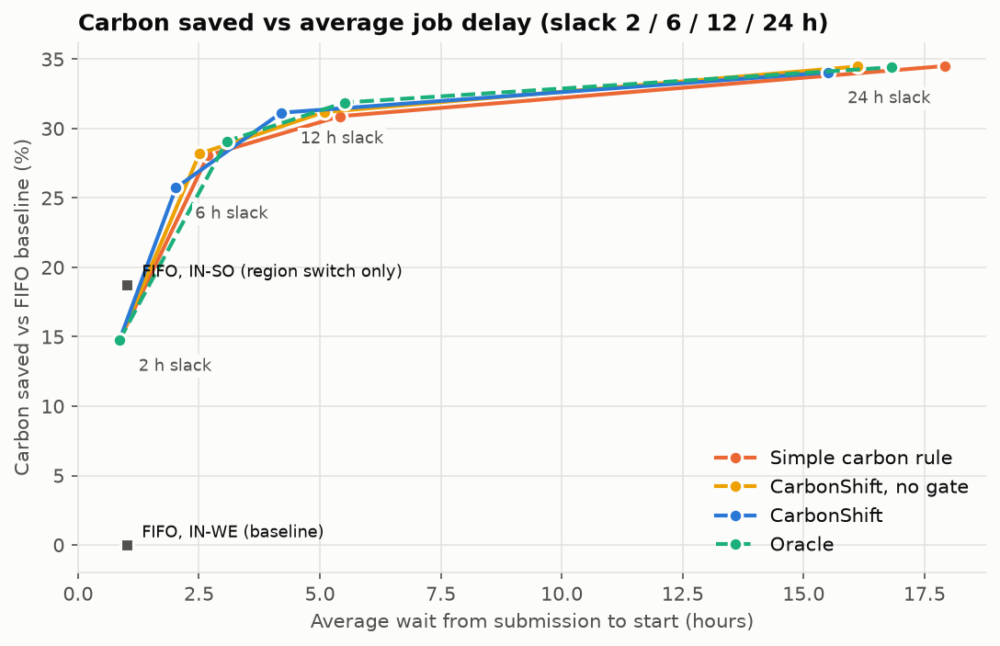

# CarbonShift — Carbon-Aware ML Resource Manager for Cloud Batch Jobs


**CarbonShift** is an ML-based cloud resource manager that **predicts workload and grid carbon intensity** and
**allocates cloud resources** accordingly. It forecasts the next 24 hours with XGBoost and decides **when**,
**where** and **on how many virtual machines** each batch job runs, so every job meets its deadline with the
lowest possible CO₂ emissions.

It runs end to end on **real AWS infrastructure**: a laptop controller drives four EC2 worker VMs through SQS
queues, collects results from DynamoDB, and switches VMs on and off as the plan requires.

> Lab IA · Advanced Cloud Computing · Semester VII

---

## 🌟 Key Highlights

- 🔮 **Two ML forecasters (1–24 h ahead):** XGBoost predicts grid carbon intensity per zone (19% / 13% lower error
  than "same hour yesterday") and the CPU-hours of work about to arrive.
- 🗓️ **Rolling-horizon scheduler:** re-plans every hour, picks the cleanest feasible hour *and* grid for each job,
  earliest deadline first, within a capacity of two VMs per group.
- 🛡️ **Safe when forecasts are wrong:** a *confidence gate* only delays a job if the predicted saving beats the
  forecast's typical error, and a *safety buffer* never plans a job into its last hour before the deadline.
- ☁️ **Real AWS deployment:** 4 × t3.micro workers, 2 SQS queues, 1 DynamoDB table, least-privilege IAM role,
  and a security group with **zero inbound rules** (no SSH).
- 📈 **Autoscaling on real VMs:** VMs are started ahead of planned work (boot ≈ 25 s), kept on through a
  cool-down, and always stopped at the end of a run, even on Ctrl+C.
- 📊 **Live Streamlit dashboard:** a plain-English "what is happening now" line, the forecast the scheduler is
  using, each VM's real EC2 state and instance ID, a job timeline, light/dark mode, and replay of finished runs.
- 🧪 **Failure injection:** surprise cloudy days and 3× workload bursts, with and without the gate and buffer.
- 🔁 **Reproducible:** seeded job streams, all tunables in `config.yaml`, 14 automated tests.
- 💰 **Cost-safe:** every resource is named `carbonshift-*` and tagged `project=carbonshift`; teardown deletes
  only those. A full 24-hour live run costs about **one US cent**.

## 📊 Results at a Glance

| Experiment | Result |
|---|---|
| Carbon forecast accuracy (2024 test year) | MAE 6.9 g (IN-WE) / 10.0 g (IN-SO), 1–2% MAPE |
| Full-year simulation (70,189 jobs, 12 h deadlines) | **31% less CO₂** than FIFO, within **1.1%** of a perfect oracle, **0%** missed deadlines |
| Live run on AWS (5 Mar 2024 replayed, 210 jobs) | CarbonShift **88 g** vs FIFO **117 g** → **24% less CO₂** on real VMs, 0 missed |
| Live burst run on AWS (8 Mar 2024, 372 jobs) | Southern group saturated → Western VMs used as overflow (111 jobs), 0 missed |
| Workload bursts (simulation, 6 h deadlines) | FIFO missed 41% of affected jobs; CarbonShift 0.09% |



## 🏗️ Architecture Overview

```
Electricity Maps CSVs ─┐
Seeded job generator ──┤
                       ▼
Laptop control plane (Python)
  ├─► Carbon forecaster     (XGBoost, 1–24 h, per grid zone)
  ├─► Workload forecaster   (XGBoost, 1–24 h, CPU-hours arriving)
  ├─► CarbonShift scheduler (rolling horizon · confidence gate · safety buffer)
  ├─► VM controller (boto3) ──── start / stop VMs ─────────────┐
  │        │                                                   │
  │        └── enqueue jobs ──► SQS carbonshift-jobs-IN-WE ──► 2 × t3.micro (worker.py)
  │                         └─► SQS carbonshift-jobs-IN-SO ──► 2 × t3.micro (worker.py)
  │                                                                  │
  │        ◄── read results ── DynamoDB carbonshift-results ◄── write timings + results
  └─► Streamlit dashboard (live view · replay · results)
```

**Grid groups.** Group A is bound to the Western Indian grid (`IN-WE`) and group B to the Southern Indian grid
(`IN-SO`). The AWS free plan allows a single region, so both groups run in `ap-southeast-2`. The live demo
replays the 2024 test year (1 simulated hour = 60 real seconds, configurable), so the physical VM location
does not change the results.

## 🚀 Quick Start (local, no AWS needed)

### 1. Prerequisites
- Python 3.11+ (developed on 3.12)
- Electricity Maps hourly CSVs for `IN-WE` and `IN-SO`, 2021–2024, in `data/raw/carbon/IN-WE/` and
  `data/raw/carbon/IN-SO/` (the folder name is the zone). Without them a synthetic stand-in is used.

### 2. Install
```bash
python3.12 -m venv .venv
.venv/bin/pip install -r requirements.txt
```

### 3. Phase 1 — data and forecasting
```bash
.venv/bin/python -m src.data.load_carbon    # clean + merge -> data/processed/carbon_hourly.csv
.venv/bin/python -m src.data.eda            # EDA charts -> results/eda_*.png
.venv/bin/python -m src.models.train        # baselines + XGBoost, h = 1..24 -> models/, results/carbon_*
.venv/bin/python -m src.data.jobs           # 2024 job stream
.venv/bin/python -m src.models.workload     # workload forecaster
```

### 4. Phase 2 — full-year simulation
```bash
.venv/bin/python -m src.sim.simulator       # 4 policies × 4 deadline slacks + failure injection (~2 min)
```

### 5. Run the tests
```bash
.venv/bin/python -m pytest -q tests         # 14 tests
```

### 6. Try the controller without AWS
```bash
.venv/bin/python -m src.cloud.controller --dry-run    # fake VMs, a whole day in ~3 seconds
```

### 7. Open the dashboard
```bash
.venv/bin/streamlit run src/dashboard/app.py          # http://localhost:8501
```

## ☁️ AWS Deployment (Phase 3)

| Resource | Configuration |
|---|---|
| EC2 | 4 × `t3.micro`, Ubuntu 24.04 (Canonical), 8 GB gp3, IMDSv2 only, 2 per group |
| SQS | `carbonshift-jobs-IN-WE`, `carbonshift-jobs-IN-SO` (visibility 120 s, long polling 20 s) |
| DynamoDB | `carbonshift-results` (on-demand, key `job_id`) |
| IAM | `carbonshift-worker-role`: SQS receive/delete on the two queues, DynamoDB `PutItem` on the table |
| Security group | `carbonshift-worker-sg`: **no inbound rules** |
| Budget | `carbonshift-guard`, $10/month alert |

**1. Log in** (temporary credentials, no access keys):
```bash
aws login
aws configure set region ap-southeast-2
```

**2. Create the resources**, either by script or by hand in the console:
```bash
infra/create.sh --plan               # show what would be created (read-only)
infra/create.sh                      # create everything, wait for the workers, then stop the VMs
infra/create.sh --render-userdata    # VM startup scripts for launching by hand -> infra/userdata/
```

**3. Run a live demo.** It replays one 2024 day on the real VMs and stops them afterwards:
```bash
.venv/bin/python -m src.cloud.controller --policy carbonshift --yes                 # 24 sim h ≈ 25 min
.venv/bin/python -m src.cloud.controller --policy fifo --yes                        # baseline
.venv/bin/python -m src.cloud.controller --scenario burst --yes                     # workload burst
.venv/bin/python -m src.cloud.controller --seconds-per-hour 20 --prewarm --yes      # presentation speed
```
Each run writes `results/live/<run_id>/{timeline.csv, jobs.csv, summary.json}`. Job results are also in
DynamoDB (filter on `run_id`). The three final runs are committed, so the dashboard can replay them right
after cloning; the "next 24 h forecast" panel appears once Phase 2 has been run locally (it needs
`data/processed/`).

**4. Manage and clean up:**
```bash
infra/vms.sh status | start | stop   # only VMs tagged project=carbonshift
infra/teardown.sh                    # delete every carbonshift-* resource (asks first)
```

**Cost:** t3.micro $0.0132/h + public IPv4 $0.005/h while running; 4 × 8 GB disks ≈ $0.10/day while they
exist. Keep VMs stopped when not testing, and run `infra/teardown.sh` after the project is assessed.

## 📂 Project Structure

```
carbonshift/
├── config.yaml                 # all tunables: regions, prices, energy coefficients, scheduler weights
├── requirements.txt
├── .streamlit/config.toml      # dashboard theme
├── infra/
│   ├── create.sh               # create AWS resources (+ --plan, --render-userdata)
│   ├── vms.sh                  # start / stop / status of the worker VMs
│   ├── teardown.sh             # delete every carbonshift-* resource
│   └── userdata/               # VM startup scripts, generated by create.sh --render-userdata (not committed)
├── src/
│   ├── data/                   # load_carbon, synthetic_carbon, eda, features, jobs
│   ├── models/                 # baselines, train (carbon XGBoost), workload, predict
│   ├── scheduler/              # policies, scheduler (rolling-horizon planner)
│   ├── sim/                    # inputs, simulator, metrics, inject (failure injection), plots
│   ├── cloud/                  # settings, worker (runs on EC2), controller (runs on the laptop)
│   ├── dashboard/app.py        # Streamlit dashboard
│   ├── plotting.py             # shared chart style
│   └── utils.py
├── results/                    # metrics CSVs + charts (Phases 1–2)
│   └── live/                   # the three final live AWS runs (timeline, jobs, summary per run)
└── tests/                      # Phase 1, 2 and 3 tests
```

## ⚙️ How the Scheduler Decides

Every simulated hour, for each waiting job in earliest-deadline-first order:
1. **Urgent?** If no hour outside the safety buffer is left, run it now in the cleanest group with capacity.
2. **Score** every feasible (group, hour) before the deadline:
   `α · forecast carbon · (job energy + idle energy of any extra VM) + β · extra VM cost + γ · delay`.
3. **Confidence gate:** only wait if the predicted saving beats the forecast's typical error at that horizon.
4. **Commit** the jobs planned for this hour, pack them onto VMs, and let the controller start/stop VMs.

## 📑 Academic Prototype Disclaimer

CarbonShift was developed as an academic engineering prototype.
- About 96% of the Electricity Maps carbon values are model estimates, and the workload is synthetic.
- Live runs **replay** the 2024 test year at 60× speed. They do not use live carbon data.
- Both worker groups run in one AWS region (free-plan limit), each bound to an Indian grid's carbon trace.
- Energy uses the Cloud Carbon Footprint linear power model; embodied and network emissions are not included.

## 📅 Submission Details

| | |
|---|---|
| **Project title** | CarbonShift — ML-based cloud resource manager that predicts workload and allocates resources |
| **Course** | Advanced Cloud Computing — Lab IA (Semester VII) |
| **Team** | Tanish Gupta (16010123132) · Tanish Shah (16010123133) · Tanisha Mukherjee (16010123134) |
| **Submission deadline** | 18 October 2026 |
| **Cloud** | AWS `ap-southeast-2`: EC2 + SQS + DynamoDB + IAM, laptop control plane |
| **Data** | Electricity Maps hourly carbon intensity, zones IN-WE and IN-SO, 2021–2024 |
